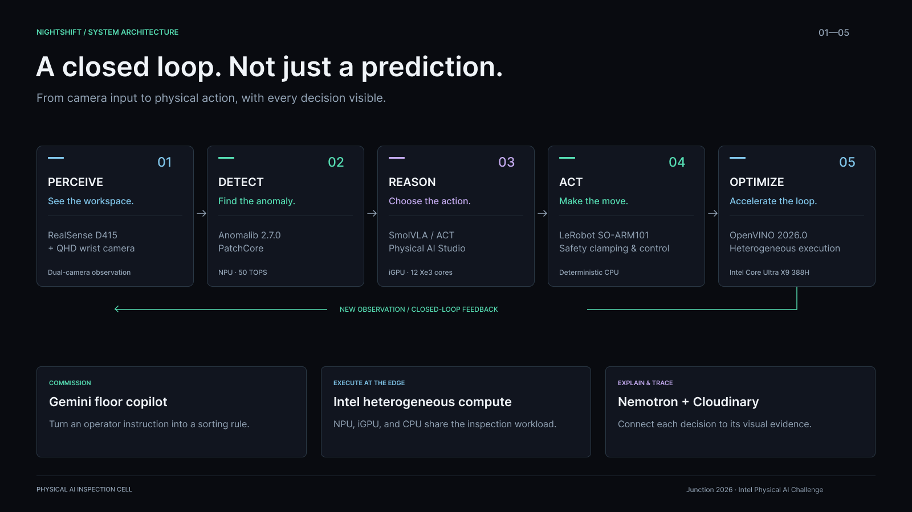

# Project Overview: Autonomous Physical AI Inspection Cell (Junction 2026)

## 1. Unified Product Architecture ("Cleanly Separated Modules, One Unified Product")

Our repository is organized as **two cleanly separated layers** connected by a single **non-blocking file & HTTP telemetry contract** (`0 ms` added latency to the robot control loop):

1. **Layer 1 — Physical Edge Cell ([`edge_cell/`](edge_cell/)):**
   - **100% standalone** physical robot and edge inference package (`cell/`, `common/`, `configs/`, `inspection/`, `models/`, `reports/`, `tests/`).
   - Runs at **30 Hz** on the **Intel Core Ultra X9 388H** laptop (`OpenVINO 2026.4`) driving the **LeRobot SO-ARM101** follower arm across 3 cameras (`top`, `inspect`, `wrist` at `640×480@30fps` via `iceoryx2`).
   - **Heterogeneous OpenVINO 2026.4 Dispatch:**
     - **Pick (`ACT v2` on Intel Arc iGPU):** `12 ms` median per `100×6` chunk (`exec_horizon=30`, re-plans every 1 s, trained on 154 demos).
     - **Inspect (`PatchCore v1` on Intel AI Boost NPU):** `181 ms` p50 (`183 ms` p95, `148 MB`, `AUROC = 0.949`, `F1 = 0.929`; `24 ms` on iGPU, `245 ms` on CPU). Keeping anomaly detection on the NPU leaves the iGPU 100% free for 30 Hz arm policies.
     - **Place (`SmolVLA v1` 450M on Intel Arc iGPU):** `104 ms` median per `50×6` chunk on GPU vs `2,325 ms` on CPU (**`22×` GPU speedup**), language-conditioned on the verdict (*"Put the brick in the good bowl."* vs *"Put the brick in the defective bowl."*).
     - **Control & Safety (`CPU`):** 30 Hz state machine + `ActionFilter` (EMA $\alpha=0.65$, $\le 5^\circ/\text{tick}$ rate clamp, workspace floor guard).
   - **Physical Sorting Setup:** **Blue Source Bowl** (input plate) $\rightarrow$ **Green GOOD Bowl** (`score < 0.45`) or **Pink DEFECT Bowl** (`score > 0.60`, white tape + blue X defects), with put-back re-grasp recovery (`[0.45, 0.60]`, `max_regrasps=1`).

2. **Layer 2 — Cloud, AI & Data Hub ([`backend/`](backend/) + [`frontend/`](frontend/)):**
   - Coupled **only** through `backend/duplo_cell_bridge.py` watching `edge_cell/runs/<run_id>/events.jsonl`, `edge_cell/runs/<run_id>/heatmaps/*.png`, `edge_cell/reports/bench/*.json`, and `edge_cell/configs/station.yaml`.
   - **All 5 Cloud & Side-Track Integrations (`5/5 LIVE` in `GET /api/health`):**
     - **Google Gemini (`gemini-3.8-flash`):** Hands-free multimodal Floor Copilot (`backend/gemini_copilot.py`).
     - **NVIDIA Nemotron (`nemotron-3.5-super-vl` on Verda B300):** Asynchronous visual root-cause reasoning and dynamic threshold calibration (`backend/nemotron_worker.py`).
     - **Cloudinary (`l_overlay`):** Programmatic inspection crop & PatchCore heatmap upload + overlay compositing (`backend/cloudinary_media.py`).
     - **MariaDB 11.8 LTS (`VECTOR(512)` + `WITH SYSTEM VERSIONING`):** Native `VEC_DISTANCE_COSINE` 512-dim defect twin search + `FOR SYSTEM_TIME ALL` temporal policy auditing (`backend/mariadb_store.py`).
     - **Modal Serverless (`modal_webhook.py`):** `@modal.fastapi_endpoint` archiving escalated defect manifests to `modal.Volume` (`junction-defect-archive`) and `modal.Dict` (`junction-escalation-state`).

---

## 2. Real Robot Verification (`run 20261114-195437` — 4/4 Sorted on Video)

In the recorded autonomous run (`run 20261114-195437`, `REAL`), the cell sorted **4 of 4 bricks** one after another with **zero human touches**:
- **Brick #1:** Pick `18.0 s` $\rightarrow$ NPU PatchCore score **`0.32`** (`GOOD`) $\rightarrow$ Green bowl (`3.9 s` place, `49.9 s` incl. initial home).
- **Brick #2:** Pick `12.7 s` $\rightarrow$ NPU PatchCore score **`0.81`** (`DEFECT`) $\rightarrow$ Pink bowl (`4.5 s` place, **`29.8 s`** total).
- **Brick #3:** Pick `18.0 s` $\rightarrow$ NPU PatchCore score **`0.05`** (`GOOD`) $\rightarrow$ Green bowl (`4.7 s` place, **`33.8 s`** total).
- **Brick #4:** NPU PatchCore score **`0.76`** (`DEFECT`) $\rightarrow$ Pink bowl (`4.4 s` place).

Full trial logs are preserved in [`edge_cell/reports/trials.md`](edge_cell/reports/trials.md) and hardware benchmark JSONs in [`edge_cell/reports/bench/`](edge_cell/reports/bench/).
