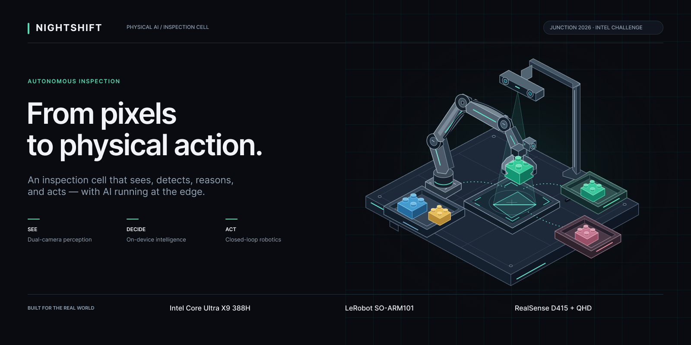
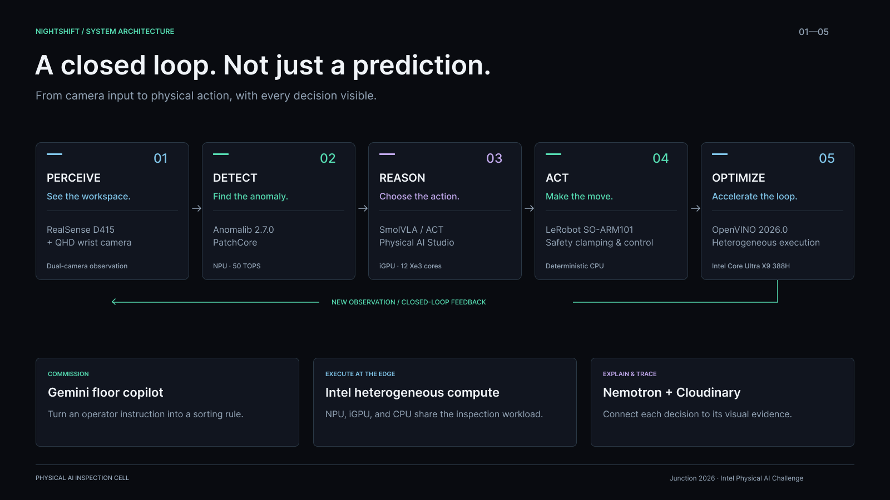

<p align="center">
  
</p>

# 🏭 Junction Helsinki 2026 — Intel Physical AI Challenge
## Team NightShift | Autonomous Duplo Brick Robotic Inspection Cell

> **Cleanly Separated Modules, One Unified Product** — Combining a **100% standalone 30 Hz Physical Edge Cell (`edge_cell/`)** on Intel Core Ultra X9 388H with an **asynchronous Cloud, AI & Data Hub (`backend/` + `frontend/`)** coupled solely through a non-blocking telemetry contract.

---

## 🧭 Architecture: Two Decoupled Layers, One Unified Product

<p align="center">
  
</p>

```
                        3 cameras (top, inspect, wrist · 640×480@30fps via iceoryx2)
                                              │
        ┌─────────────────────────────────────┼──────────────────────────────────────┐
        ▼                                     ▼                                      ▼
  ACT v2 (OpenVINO, GPU)            PatchCore v1 (Anomalib, NPU)          SmolVLA 450M (OpenVINO, GPU)
  "pick a brick and show it"        148 MB · AUROC 0.949 · F1 0.929       "put in the good bowl"
  chunk 100×6 · 12 ms median        181 ms NPU (leaves GPU 100% free)     "put in the defective bowl"
        │                           t_low = 0.45 · t_high = 0.60          chunk 50×6 · 104 ms (22× vs CPU)
        └──────────────► 30 Hz State Machine + ActionFilter (CPU) ◄──────────────────┘
                                              │
                                    SO-ARM101 Follower Arm
                       (Blue Source Bowl ──► Green GOOD / Pink DEFECT Bowl)
                                              │
                       Non-blocking telemetry │ runs/<id>/events.jsonl + heatmaps/*.png
                                              ▼
                     ┌────────────────────────────────────────────────┐
                     │     backend/duplo_cell_bridge.py (0 ms lag)    │
                     └────────────────────────┬───────────────────────┘
                                              ▼
        ┌────────────────────────────────────────────────────────────────────────────┐
        │                  Layer 2: Cloud, AI & Data Hub (5/5 LIVE)                  │
        ├────────────────┬────────────────┬────────────────┬────────────┬────────────┤
        │ Gemini 3.8     │ Verda B300     │ Cloudinary     │ MariaDB    │ Modal      │
        │ Flash Copilot  │ Nemotron VL    │ l_overlay      │ 11.8 LTS   │ Serverless │
        │ Voice/Webcam   │ Root-Cause &   │ Raw + Heatmap  │ VECTOR(512)│ Volume +   │
        │ Policy Rules   │ Threshold Tune │ Composite CDN  │ + Temporal │ Dict Audit │
        └────────────────┴────────────────┴────────────────┴────────────┴────────────┘
```

### Layer 1 — Physical Edge Cell (`edge_cell/`)
Runs **100% locally** on the station laptop (**Intel Core Ultra X9 388H**, Intel Arc iGPU, Intel AI Boost NPU, Ubuntu 26.04, OpenVINO 2026.4) with zero cloud dependency at control time:
- **Pick (`ACT v2` on Intel Arc iGPU):** `models/policy/act_v2`, chunk `100×6`, `exec_horizon=30` (re-plans from fresh camera images every 1 s), **`12 ms`** median chunk latency on GPU, trained on **154 demos**.
- **Inspect (`PatchCore v1` on Intel AI Boost NPU):** `models/anomaly/patchcore_v1` (Anomalib 2.7.0, WideResNet-50, `148 MB`, `image_AUROC = 0.949`, `image_F1 = 0.929`), **`181 ms` p50 on NPU** (`24 ms` on iGPU, `245 ms` on CPU). Running inspection on the NPU leaves the iGPU **100% dedicated** to multi-Hz arm control.
- **Place (`SmolVLA v1` 450M on Intel Arc iGPU):** `models/policy/current`, chunk `50×6`, language-conditioned on the inspection verdict (*"Put the brick in the good bowl."* vs *"Put the brick in the defective bowl."*), **`104 ms` median on GPU vs `2,325 ms` on CPU (`22×` GPU speedup)**.
- **30 Hz Deterministic Control & Recovery (`CPU`):** Explicit state machine (`HOME → PICK_PRESENT → SNAP_TO_INSPECT → INSPECT → DECIDE → PLACE_GOOD / PLACE_DEFECT / REGRASP → CONFIRM → DONE`) + `ActionFilter` (EMA $\alpha=0.65$, $\le 5^\circ/\text{tick}$ clamp, workspace guard). Uncertain scores (`[0.45, 0.60]`) trigger a put-back re-grasp (`max_regrasps=1`) with conservative `DEFECT` fallback.

### Layer 2 — Cloud, AI & Data Hub (`backend/` + `frontend/`)
Coupled **only** through the non-blocking telemetry contract (`runs/<run_id>/events.jsonl`, `runs/<run_id>/heatmaps/*.png`, `reports/bench/*.json`, and `configs/station.yaml`):
1. **Precision Optics Mission Control (`frontend/`):** React 19 + Framer Motion + Tailwind CSS cockpit streaming live FSM transitions, dual-camera ROI/heatmap overlays, `t_low=0.45 / t_high=0.60` decision gauge, and OpenVINO 2026.4 silicon benchmarks over `/ws/live`.
2. **Gemini 3.8 Flash Floor Copilot (`backend/gemini_copilot.py`):** Multimodal operator commissioning via webcam, microphone, or text prompt with spoken synthesis confirmation.
3. **Verda B300 NVIDIA Nemotron 3.5 Super VL (`backend/nemotron_worker.py`):** Asynchronous visual root-cause reasoning and anomaly threshold calibration.
4. **Cloudinary Visual Vault (`backend/cloudinary_media.py`):** Programmatic raw crop & PatchCore heatmap uploads with chained `l_overlay` compositing.
5. **MariaDB 11.8 LTS `VECTOR(512)` + `WITH SYSTEM VERSIONING` (`backend/mariadb_store.py`):** Native `VEC_DISTANCE_COSINE` 512-dim defect twin search (`GET /api/cycles/{id}/similar`) plus temporal `FOR SYSTEM_TIME ALL` policy audit history (`GET /api/policies/history`).
6. **Modal Serverless Escalation (`backend/modal_webhook.py`):** `@modal.fastapi_endpoint` persisting escalated defect manifests to `modal.Volume` (`junction-defect-archive`) and `modal.Dict` (`junction-escalation-state`).

---

## 📊 Real Robot Results & OpenVINO 2026.4 Benchmarks

### Recorded Autonomous Run (`run 20261114-195437`, `REAL` — 4/4 Bricks Sorted, 0 Human Touches)
Full sorting loop (`pick → inspect → verdict → place → return home`) recorded on video with **4 of 4 bricks sorted into the correct bowl** (2 good → **green bowl**, 2 white-tape + blue-X defective → **pink bowl**):

| Brick | Pick (`ACT v2` GPU) | Defect Score (`PatchCore v1` NPU) | Verdict → Bowl | Place (`SmolVLA v1` GPU) | Total Brick Cycle |
|---:|---:|---:|---|---:|---:|
| **#1** | `18.0 s` | **`0.32`** (`< 0.45`) | **GOOD → Green Bowl** | `3.9 s` | `49.9 s` *(incl. initial home)* |
| **#2** | `12.7 s` | **`0.81`** (`> 0.60`) | **DEFECT → Pink Bowl** | `4.5 s` | **`29.8 s`** |
| **#3** | `18.0 s` | **`0.05`** (`< 0.45`) | **GOOD → Green Bowl** | `4.7 s` | **`33.8 s`** |
| **#4** | `—` | **`0.76`** (`> 0.60`) | **DEFECT → Pink Bowl** | `4.4 s` | `—` |

- **Score separation:** Good bricks scored **`0.05–0.33`** (`GOOD < 0.45`); defective bricks (white tape + blue X) scored **`0.76–0.85`** (`DEFECT > 0.60`).
- **Why hybrid `ACT v2` + `SmolVLA v1`:** `SmolVLA` achieved **3/3** (`100%`, `3.3–4.1 s`) on language-conditioned bowl placement, whereas `ACT v2` achieved **2.5/3** (`11.7–12.8 s`) on picking from the blue source bowl by re-planning every 1 s.

### Measured OpenVINO 2026.4 Hardware Matrix (Intel Core Ultra X9 388H)
Synced directly from [`edge_cell/reports/bench/`](edge_cell/reports/bench):

| Model | Workload | Device | Precision | Median / p50 | p95 | Throughput | Compile | Quality / Notes |
|---|---|---|---|---:|---:|---:|---:|---|
| **`patchcore_v1`** | Anomaly (`148 MB`) | **NPU** *(chosen)* | `FP16` | **`181 ms`** | `183 ms` | `5.5 FPS` | `9.2 s` | `AUROC 0.949`, `F1 0.929` · Frees iGPU 100% |
| **`patchcore_v1`** | Anomaly (`148 MB`) | **iGPU (`GPU`)** | `FP16` | **`24 ms`** | `26 ms` | `41.7 FPS` | `1.2 s` | `AUROC 0.949`, `F1 0.929` (12 val frames) |
| **`patchcore_v1`** | Anomaly (`148 MB`) | **CPU** | `FP32` | **`245 ms`** | `247 ms` | `4.1 FPS` | `0.4 s` | `AUROC 0.949`, `F1 0.929` |
| **`act_v2`** | Pick (`100×6` chunk) | **iGPU (`GPU`)** | `FP16` | **`12 ms`** | `13.8 ms` | `83.3 Hz` | `1.4 s` | `2.5/3` real picks (`exec_horizon=30`) |
| **`smolvla_v1`** | Place (`450M`, `50×6`) | **iGPU (`GPU`)** | `FP16` | **`104 ms`** | `119.6 ms` | `9.6 Hz` | `15.2 s` | **`22×` faster than CPU** · `3/3` real places |
| **`smolvla_v1`** | Place (`450M`, `50×6`) | **CPU** | `FP32` | **`2,325 ms`** | `2,480 ms` | `0.43 Hz` | `6.9 s` | `2.3 s` pause per 50-step chunk on CPU |

---

## 🗂 Repository Structure

```text
F:\JunctionH 2026
├── edge_cell/                  # Layer 1: Standalone Physical Arm & Edge AI Stack (Ubuntu 26.04)
│   ├── cell/                   # 30 Hz state machine, ACT/SmolVLA runner, ActionFilter, cameras
│   ├── common/                 # Shared contracts (InspectionResult, CellEvent) & JSONL logger
│   ├── configs/station.yaml    # Station calibration, poses, t_low=0.45 / t_high=0.60, devices
│   ├── inspection/             # Anomalib 2.7.0 PatchCore v1 OpenVINO NPU/GPU/CPU service
│   ├── models/                 # MODEL_CARD.json metadata (patchcore_v1, act_v2, smolvla_v1)
│   ├── reports/                # Measured OpenVINO bench/*.json & real robot trials.md
│   ├── tests/                  # Unit tests for state machine & safety filter
│   └── start_demo.sh           # Station launch script (--real or --mock)
├── backend/                    # Layer 2A: Unified Cloud, AI & Data Hub (FastAPI + WebSockets)
│   ├── main.py                 # REST + /ws/live hub, state store, background cloud enrichment
│   ├── duplo_cell_bridge.py    # Non-blocking watcher for edge_cell/runs, heatmaps & benchmarks
│   ├── gemini_copilot.py       # Gemini 3.8 Flash multimodal operator rule extraction
│   ├── nemotron_worker.py      # Verda B300 NVIDIA Nemotron 3.5 Super VL root-cause worker
│   ├── cloudinary_media.py     # Cloudinary upload + l_overlay heatmap compositor
│   ├── mariadb_store.py        # MariaDB 11.8 VECTOR(512) + WITH SYSTEM VERSIONING store
│   └── modal_webhook.py        # Modal Serverless escalation endpoint (Volume + Dict)
└── frontend/                   # Layer 2B: Precision Optics Mission Control UI (React + Vite)
    └── src/                    # Cockpit, DualCameraFeed, IntelTelemetry, GeminiCopilot, Archive
```

---

## ⚡ Quick Start Guide

### 1. Start the Cloud, AI & Data Hub (`backend/` + `frontend/`)
```powershell
# 1. Start FastAPI Hub on port 8000
cd backend
.\.venv\Scripts\uvicorn.exe main:app --host 0.0.0.0 --port 8000

# 2. Start Vite Mission Control UI on port 5173
cd ../frontend
npm install
npm run dev
```
- **Mission Control UI:** `http://localhost:5173`
- **Live Cloud Health (`5/5 LIVE`):** `http://localhost:8000/api/health`

### 2. Run the Physical Edge Cell (`edge_cell/`) & Bridge (`duplo_cell_bridge.py`)
```powershell
# Run edge_cell unit tests & generate a mock 5-brick run
cd edge_cell
..\backend\.venv\Scripts\python.exe -m pytest
..\backend\.venv\Scripts\python.exe -m cell.run --mock

# Sync edge_cell runs, heatmaps, station.yaml & OpenVINO benchmarks to the Cloud Hub
cd ..
.\backend\.venv\Scripts\python.exe backend\duplo_cell_bridge.py --watch edge_cell --once --hub http://localhost:8000
```
On the physical Ubuntu station laptop with the SO-ARM101 arm connected:
```bash
cd edge_cell && ./start_demo.sh --real
# In a second terminal, stream live events & heatmaps to the Cloud Hub:
python3 ../backend/duplo_cell_bridge.py --watch . --hub http://<HUB_HOST>:8000
```
